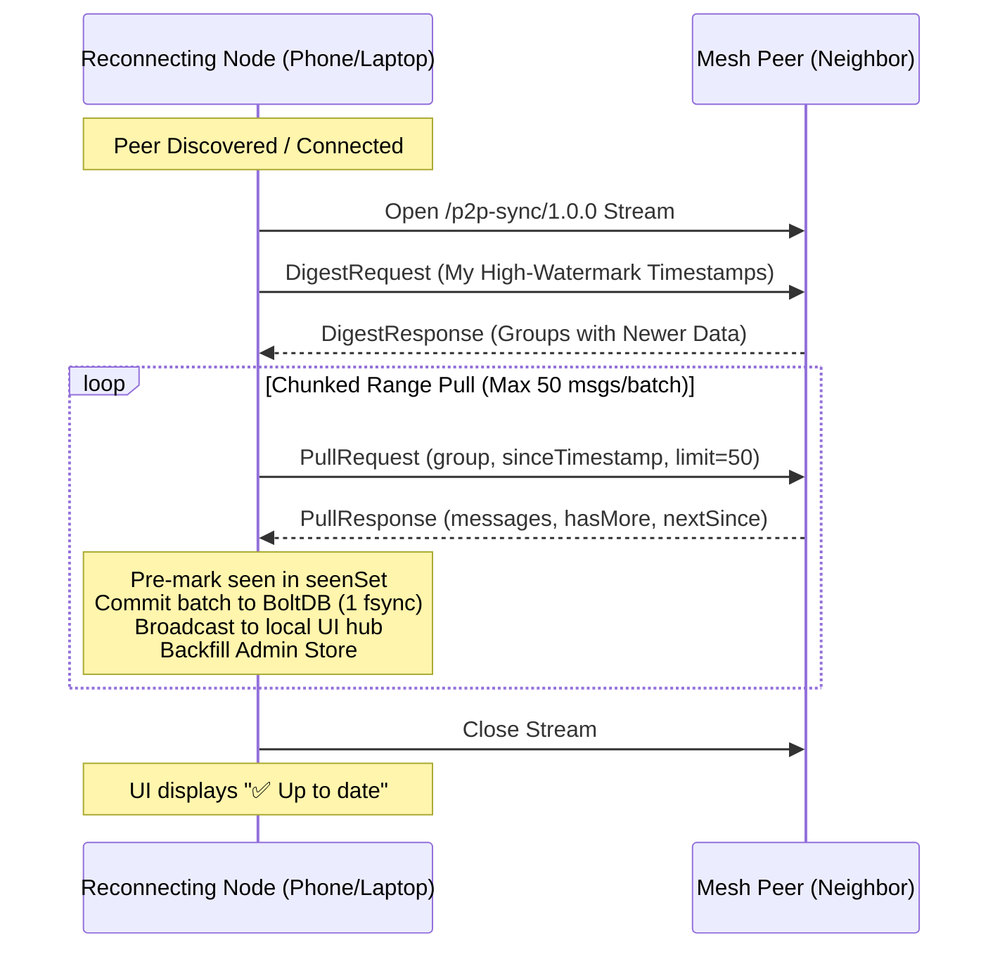

# LANMesh — Serverless P2P Mesh Network & Admin Reference System

> **Serverless, peer-to-peer ad-hoc mesh communication over local Wi-Fi & LAN.**  
> No internet access, no external servers, no cloud databases, and no user accounts required. Run the binary on your laptop or install the mobile APK on your phone, and you are immediately live on the mesh.

---

## Table of Contents
1. [Overview & Core Value](#overview--core-value)
2. [System Architecture](#system-architecture)
   - [Mesh Topology & Multi-Hop Relays](#mesh-topology--multi-hop-relays)
   - [Dual-Protocol Isolation (`/p2p-chat` vs `/p2p-sync`)](#dual-protocol-isolation-p2p-chat-vs-p2p-sync)
   - [Dual-Discovery Engine (mDNS + UDP LAN Beacon)](#dual-discovery-engine-mdns--udp-lan-beacon)
3. [Android Full Native Peer App (`lanmesh.apk`)](#android-full-native-peer-app-lanmeshapk)
   - [Mobile Architecture & Daemon Lifecycle](#mobile-architecture--daemon-lifecycle)
   - [Wi-Fi MulticastLock & Background Doze Handling](#wi-fi-multicastlock--background-doze-handling)
   - [Redistributable Standalone Release APK](#redistributable-standalone-release-apk)
4. [Technology Stack](#technology-stack)
5. [Source Code Structure](#source-code-structure)
6. [Storage & Database Engine (BoltDB)](#storage--database-engine-boltdb)
7. [Catch-Up Synchronization Engine (`/p2p-sync/1.0.0`)](#catch-up-synchronization-engine-p2p-sync100)
8. [Admin Node & Offline Audit Synchronization](#admin-node--offline-audit-synchronization)
   - [Boot-Time Activation & Authentication](#boot-time-activation--authentication)
   - [Automated BoltDB Audit Backfill](#automated-boltdb-audit-backfill)
   - [Forensic JSONL Audit Log](#forensic-jsonl-audit-log)
9. [WebRTC Audio/Video Calling & Group Rooms (`/lanmesh-call/1.0.0`)](#webrtc-audiovideo-calling--group-rooms-lanmesh-call100)
   - [Signaling Architecture & Libp2p Stream Protocol](#signaling-architecture--libp2p-stream-protocol)
   - [1:1 Direct Audio & Video Calls](#11-direct-audio--video-calls)
   - [Multi-Party Group Video Rooms](#multi-party-group-video-rooms)
10. [Wire Protocol (`ChatMessage` & `SignalEnvelope`)](#wire-protocol-chatmessage--signalenvelope)
11. [HTTP & WebSocket API Reference](#http--websocket-api-reference)
12. [Frontend & Web UI Features](#frontend--web-ui-features)
    - [Messaging & Rich Media](#messaging--rich-media)
    - [WebRTC Calling Interface](#webrtc-calling-interface)
    - [QR Code Peer Discovery & Sharing](#qr-code-peer-discovery--sharing)
    - [Topology & Diagnostics](#topology--diagnostics)
13. [CLI Flags Reference](#cli-flags-reference)
14. [Build & Deployment Instructions](#build--deployment-instructions)
    - [Desktop (Windows / Linux / macOS)](#desktop-windows--linux--macos)
    - [Android Cross-Compilation & Release APK](#android-cross-compilation--release-apk)
15. [What is Done vs. What is Pending](#what-is-done-vs-what-is-pending)
16. [Key Design Decisions & Trade-offs](#key-design-decisions--trade-offs)

---

## Overview & Core Value

LANMesh turns standard off-the-shelf laptops, PCs, Raspberry Pis, and Android smartphones into self-healing, autonomous communication clusters. Designed specifically for isolated or degraded networks (disaster response zones, campus intranets, underground mines, off-grid field expeditions, conference dead-zones):

* **Zero Infrastructure Setup:** Operates on local Wi-Fi, mobile hotspots, or Ethernet switches without requiring an internet connection, external gateways, routers, or DNS servers.
* **Full Autonomous P2P Nodes:** Every device—including Android phones—runs its own embedded libp2p host, stores its own BoltDB database, and routes traffic for other peers.
* **Multi-Hop Range Extension:** Devices out of direct Wi-Fi range communicate seamlessly through intermediate devices acting as bridges.
* **Dual Zero-Config Auto-Discovery:** Employs both link-local mDNS (`224.0.0.251:5353`) and a resilient UDP LAN Broadcast Beacon (`255.255.255.255:9999`) to bypass mobile OS sandbox restrictions.
* **Bidirectional Catch-Up Sync:** Devices that rejoin the network after hours offline automatically sync missed messages in point-to-point chunked streams.
* **Authoritative Admin Node:** Supports dedicated forensic audit stations that maintain tamper-resistant logs and anchor the network's reference history.

---

## System Architecture

### Mesh Topology & Multi-Hop Relays

LANMesh operates as an unmanaged flood-relay mesh with dynamic loop prevention:

```
[ LAN 1 Subnet ]                 [ LAN 2 Subnet ]                 [ LAN 3 Subnet ]
┌──────────────┐                 ┌──────────────┐                 ┌──────────────┐
│   Laptop 1   │                 │ Android Phone│                 │   Laptop 3   │
│  (Edge Node) │                 │  (Mid Node)  │                 │  (Edge Node) │
└──────┬───────┘                 └──────┬───────┘                 └──────┬───────┘
       │                                │                                │
       │ Direct Beacon / TCP            │ Direct Beacon / TCP            │
       ▼                                ▼                                ▼
┌──────────────────────────────┐ ┌──────────────────────────────┐
│      Laptop 2 (BRIDGE)       │ │     Admin Station (BRIDGE)   │
│  - Dual-NIC (LAN 1 + LAN 2)  │ │  - Dual-NIC (LAN 2 + LAN 3)  │
│  - Forwards Hop 1 → Hop 2    │ │  - Forwards Hop 2 → Hop 3    │
└──────────────────────────────┘ └──────────────────────────────┘
```

* **Hop Counter & Bounded TTL:** Every message carries a hop counter (`Hops <= 6`). Nodes increment the counter upon relaying. Messages exceeding 6 hops are dropped to prevent infinite packet propagation.
* **Loop Prevention (`relay.go`):** Each node maintains an in-memory FIFO seen-cache (`globalSeen`, 5,000 entry cap). Any message ID already in the cache is discarded immediately, preventing broadcast storms.
* **Isolated Fan-Out Goroutines:** Relaying to neighbors occurs in independent goroutines with 5-second dial timeouts; an unresponsive neighbor cannot stall relaying to other nodes.

---

### Dual-Protocol Isolation (`/p2p-chat` vs `/p2p-sync`)

Real-time chat traffic and database catch-up streams are strictly segregated into two distinct libp2p protocol handlers to avoid head-of-line blocking and voice note stutter:

```
┌─────────────────────────────────────────────────────────────────────────┐
│                          LANMesh Node Architecture                      │
│                                                                         │
│   Web / Flutter UI (Client Interface)                                   │
│         ▲                                                               │
│         │ Loopback WebSocket (ws://127.0.0.1:PORT/ws)                   │
│         ▼                                                               │
│   ┌───────────────┐     ┌──────────────────────────────────────────┐    │
│   │ WebSocket Hub │◄───►│ Broadcast Dispatcher & BoltDB Storage    │    │
│   └───────────────┘     └──────────────────────────────────────────┘    │
│                                       ▲                                 │
│                     ┌─────────────────┴─────────────────┐               │
│                     ▼                                   ▼               │
│        /p2p-chat/1.0.0 (Live Flow)         /p2p-sync/1.0.0 (Sync Flow)  │
│        - Multi-hop flood relay             - Point-to-point anti-entropy│
│        - Ephemeral typing / pings          - Chunked range queries      │
│        - Real-time chat & media            - Rate-limited & debounced   │
│                     │                                   │               │
│                     ▼                                   ▼               │
│               libp2p Host (TLS 1.3 Transport, Ed25519 Peer ID)          │
│                     ▲                                                   │
│         ┌───────────┴──────────────────────────┐                        │
│         ▼                                      ▼                        │
│   mDNS Discovery (224.0.0.251:5353)      UDP Beacon (255.255.255.255:9999)
│         ▲                                      ▲                        │
│         └───────────┬──────────────────────────┘                        │
│                     ▼                                                   │
│               Physical Network Interfaces (0.0.0.0:*)                   │
└─────────────────────────────────────────────────────────────────────────┘
```

1. **`/p2p-chat/1.0.0` (Live Relay):** Lightweight, fire-and-forget streams with hop increments for instantaneous low-latency messaging.
2. **`/p2p-sync/1.0.0` (Anti-Entropy Catch-Up):** Point-to-point, chunked, rate-limited TCP/TLS reconciliation streams for offline history syncing.

---

### Dual-Discovery Engine (mDNS + UDP LAN Beacon)

Discovery operates through two concurrent mechanisms to ensure seamless connectivity across different operating systems:

1. **Multicast DNS (`mdns.go`):**
   * Uses ZeroConf multicast over `224.0.0.251:5353` service `_p2p._udp.local`.
   * Fast, native discovery on desktop operating systems (Windows, Linux, macOS).
2. **UDP LAN Broadcast Beacon (`beacon.go`):**
   * **The Mobile Challenge:** On Android 11+ (API 30+), OS SELinux sandboxes strictly block non-root applications from reading network route tables via netlink (`route ip+net: netlinkrib: permission denied`), causing standard mDNS libraries to fail.
   * **The Solution:** A dedicated UDP broadcast beacon service on port `9999` broadcasts to `255.255.255.255` every 2.5 seconds.
   * When any peer receives a beacon, it extracts the sender's libp2p multiaddress, automatically substitutes `0.0.0.0` with the sender's real UDP source IP, and immediately dials `host.Connect()`.

---

## Android Full Native Peer App (`lanmesh.apk`)

Unlike traditional mobile companion apps that act as thin clients dependent on a desktop server, the LANMesh Android app is an **autonomous, first-class peer node**. Two Android phones can form a full mesh in an open field over a mobile hotspot without any laptop or server present.

```
┌────────────────────────────────────────────────────────┐
│                   ANDROID MOBILE DEVICE                │
│                                                        │
│  ┌──────────────────────────────────────────────────┐  │
│  │               Flutter UI (main.dart)             │  │
│  │  - Dark Mesh Theme (#0B0B0C & #F2C230 Gold)    │  │
│  │  - Live Status Pill ("PEER ACTIVE :8080")        │  │
│  │  - One-tap Peer ID copy & Daemon Logs inspector  │  │
│  │  - Fullscreen interactive chat webview           │  │
│  └────────────────────────▲─────────────────────────┘  │
│                           │ Localhost (127.0.0.1:8080) │
│                           ▼                            │
│  ┌──────────────────────────────────────────────────┐  │
│  │         Android Host Layer (MeshService.kt)      │  │
│  │  - Foreground Service with sticky notification   │  │
│  │  - MulticastLock (unblocks mDNS UDP packets)     │  │
│  │  - Partial WakeLock (prevents CPU sleep in pocket│  │
│  │  - Subprocess Daemon managing `liblanmesh.so`    │  │
│  └────────────────────────▲─────────────────────────┘  │
│                           │ Process Stdout/Stderr      │
│                           ▼                            │
│  ┌──────────────────────────────────────────────────┐  │
│  │             Embedded Go Engine (ARM64)           │  │
│  │  - libp2p Host (Ed25519 identity, TLS 1.3)       │  │
│  │  - Multi-hop Flood Relay (/p2p-chat/1.0.0)       │  │
│  │  - Catch-up Sync Engine (/p2p-sync/1.0.0)        │  │
│  │  - Embedded BoltDB (lanmesh.db in app storage)   │  │
│  │  - UDP Broadcast Beacon (:9999)                  │  │
│  └──────────────────────────────────────────────────┘  │
└────────────────────────────────────────────────────────┘
```

### Mobile Architecture & Daemon Lifecycle
* **No Codebase Refactoring:** Packages the pure Go ARM64 ELF binary (`liblanmesh.so`) directly inside `jniLibs/arm64-v8a/` and fallback `assets/`.
* **Execution:** On launch, the Android host initializes `MeshService.kt`, extracts the binary into the app's sandboxed storage (`context.filesDir`), and launches it via `ProcessBuilder` with `-data-dir /data/user/0/.../files/meshdata -port 8080`.

### Wi-Fi MulticastLock & Background Doze Handling
* **`WifiManager.MulticastLock`:** Android Wi-Fi drivers filter out multicast packets by default to preserve battery. The service explicitly acquires and holds a multicast lock to keep UDP sockets open.
* **`PowerManager.PARTIAL_WAKE_LOCK`:** Prevents the Android CPU from entering deep sleep when the screen is locked, enabling the phone to route mesh packets while in a user's pocket.
* **Foreground Service:** Runs with a persistent low-priority status notification (`LANMesh P2P Engine: Active • Wi-Fi Mesh Relay Running`), preventing OS task-killer eviction.

### Redistributable Standalone Release APK
* **Standalone Binary:** Compiled as **`lanmesh.apk`** (48.0 MB, optimized release build).
* **Official Certificate:** Signed using a dedicated 2048-bit RSA release keystore (`lanmesh-release.jks`) valid for 27 years (10,000 days).
* **Zero Host Prerequisite:** Any Android user can download `lanmesh.apk` (via WhatsApp, Google Drive, or USB), tap to install, and immediately join the mesh without developer mode or a PC.

---

## Technology Stack

| Layer | Component | Description |
|---|---|---|
| **Core Engine** | Go 1.22+ | 100% pure Go with zero CGO dependencies. Cross-compiles across all platforms. |
| **Networking** | `go-libp2p` v0.47 | TLS 1.3 security transport, Ed25519 host identities, stream multiplexing. |
| **Discovery** | mDNS & UDP Beacon | ZeroConf multicast (`5353`) + LAN broadcast beacon (`9999`) for 100% OS coverage. |
| **Storage** | `go.etcd.io/bbolt` | ACID key-value embedded B-Tree database with 16-byte composite keys. |
| **WebSocket** | `gorilla/websocket` | Real-time browser-to-node multiplexing with auto-reconnect handling. |
| **Frontend** | Vanilla HTML5 / CSS3 / JS | Pure web technologies embedded into binary via `embed.FS`. No Node/Webpack build steps. |
| **Mobile App** | Flutter 3.47+ / Kotlin | Material 3 dark-themed mobile container with Android Foreground Service. |
| **Mobile Signing** | Java Keytool / RSA | 2048-bit production keystore (`lanmesh-release.jks`) for redistributable APKs. |

---

## Source Code Structure

```
LANMesh/
├── main.go               # Hub, BoltDB storage, HTTP/WS endpoints, discovery, and CLI flags
├── sync.go               # /p2p-sync/1.0.0 engine: two-phase digest handshake & chunked range sync
├── admin.go              # HMAC-SHA256 auth, session cookies, JSONL audit log, /admin dashboard
├── beacon.go             # UDP broadcast discovery beacon (:9999) for cross-platform LAN discovery
├── relay.go              # In-memory seenSet deduplication cache and FIFO eviction queue
├── mdns.go               # mDNS ZeroConf multicast service registration and auto-dialer
├── static/
│   └── index.html        # Responsive frontend chat UI, WebSocket client, and topology visualizer
├── mobile/               # Complete Flutter & Android native mobile application
│   ├── lib/main.dart     # Dark-themed Flutter client with status monitor & embedded WebView
│   ├── android/          # Android wrapper project with Foreground Service & native loader
│   │   ├── app/src/main/kotlin/com/lanmesh/lanmesh_mobile/
│   │   │   ├── MainActivity.kt  # MethodChannel bridge to start/stop engine & query peer state
│   │   │   └── MeshService.kt   # Foreground Service, MulticastLock, WakeLock & process manager
│   │   ├── lanmesh-release.jks  # Production release keystore
│   │   └── key.properties       # Keystore build properties
├── lanmesh.exe           # Compiled desktop executable (Windows)
├── lanmesh-admin.exe     # Compiled admin reference node (Windows)
├── lanmesh-android       # Compiled native ARM64 Android ELF executable
└── lanmesh.apk           # Standalone redistributable Android Release APK (48 MB)
```

---

## Storage & Database Engine (BoltDB)

Each node stores messages locally in an embedded BoltDB file (`lanmesh.db`).

### Timestamp-Prefixed Composite Keys
Because simple sequence numbers (`1, 2, 3...`) collide across decentralized peers, LANMesh indexes messages using a **16-byte composite key**:
```
┌───────────────────────────────────────┬──────────────────────────────────────┐
│  8 Bytes: UnixMs Timestamp (BigEndian)│  8 Bytes: Deterministic Hash of ID   │
└───────────────────────────────────────┴──────────────────────────────────────┘
```
* **$O(\log N)$ Range Seeks:** BoltDB B-Trees sort keys lexicographically. Seeking messages after timestamp $T$ performs an instant cursor seek (`c.Seek(seekKey)`), eliminating full-table scans.

### Bucket Layout
* **Group Buckets (`general`, `<group_name>`):** Stores chronological JSON message payloads.
* **`__groups__` Bucket:** Registry of all known group channels created across the mesh.
* **`msg_index` Bucket:** Global hash index mapping `messageId -> groupId` for $O(1)$ duplicate checking before committing synced batches.

### Identity Persistence (`peer.key`)
An Ed25519 private key is persisted at `peer.key` within the node's data directory. Node peer IDs (e.g. `12D3KooW...`) survive restarts and reboots.

---

## Catch-Up Synchronization Engine (`/p2p-sync/1.0.0`)

When a phone or laptop reconnects after being offline, it synchronizes with neighbors automatically:



### Resource & Network Overload Safeguards
1. **Stream Concurrency Semaphore:** `syncSem` limits simultaneous sync streams to **2** per machine, preventing CPU, disk, and Wi-Fi interface saturation.
2. **Peer Debounce Cooldown:** `canSyncWith(peerID)` enforces a **45-second debounce window** per peer, preventing connection-flapping sync storms.
3. **Zero Live-Relay Echo:** Synced historical messages are pre-marked in `markSeen()` before persistence so they are **never re-broadcast** over the live flood relay.
4. **Single-Transaction Disk Batches:** `saveBatch()` commits up to 50 messages per database transaction (1 disk fsync instead of 50).
5. **Timeline Order Preservation:** The frontend sorts messages by timestamp upon receiving backfilled messages so they slot into proper chronological position.

---

## Admin Node & Offline Audit Synchronization

An admin node acts as the long-term Point of Contact (POC) and forensic reference database for the mesh.

### Boot-Time Activation & Authentication
* **Boot-Time Initialization:** If `adminSecret != ""` (via `-ldflags` or runtime `-admin-secret`), admin logging starts **immediately on process launch** without waiting for a user to log into the browser.
* **HMAC-SHA256 Challenge-Response Login:**
  1. Browser requests a cryptographic nonce via `GET /admin/challenge` (2-minute TTL).
  2. Browser computes `HMAC-SHA256(nonce, password)` locally via WebCrypto; the raw password never travels over the wire.
  3. Server validates HMAC in constant time and issues an 8-hour `HttpOnly`, `SameSite=Strict` session cookie.

### Automated BoltDB Audit Backfill
* **The Problem:** If an admin station is powered off while peers exchange messages, the admin misses those messages in real time.
* **The Solution (`store.backfillFromDB()`):**
  1. When the admin node connects to the network, the catch-up sync engine pulls all missing messages into `lanmesh.db`.
  2. As messages arrive, the admin store ingests them in real time.
  3. Upon sync completion, `store.backfillFromDB()` scans all group buckets in `lanmesh.db` and writes any missing messages into `lanmesh-admin-log.jsonl`.
  4. An in-memory `seenIDs` map ensures duplicate messages are never recorded twice.
  5. The **`/admin`** dashboard displays the complete, unified history across the entire mesh.

### Forensic JSONL Audit Log
* **Location:** Stored in `./admin-data/lanmesh-admin-log.jsonl`.
* **Captured Events:** Text messages, file uploads, locations, voice notes, message edits, and deletions (ephemeral pings and typing indicators are filtered out).
* **Export:** Authenticated admins can download the entire audit trail as a single JSON file via `GET /admin/export.json`.
* **Automated Periodic Self-Ping:** Admin nodes run a dedicated background goroutine broadcasting a `ping` frame every 20 seconds using their configured nickname, keeping their entry refreshed in every peer's live presence roster.

---

## WebRTC Audio/Video Calling & Group Rooms (`/lanmesh-call/1.0.0`)

LANMesh includes a completely serverless WebRTC audio and video calling subsystem (`call.go`). Because LANMesh operates entirely without internet access or centralized STUN/TURN servers, WebRTC session negotiation (SDP offers, answers, and ICE candidate exchange) is carried out **directly over the libp2p mesh network** via a dedicated stream protocol.

```
┌────────────────────────────────────────────────────────┐
│                      Browser A                         │
│   WebRTC PeerConnection  ──(Audio/Video RTP Streams)── │◄──┐
└───────────────────────────┬────────────────────────────┘   │ Direct Local LAN
                            │ WS /signal                     │ P2P Media Stream
┌───────────────────────────▼────────────────────────────┐   │
│                 Go Daemon (Node A)                     │   │
│  libp2p Host ───[/lanmesh-call/1.0.0 stream]───┐       │   │
└────────────────────────────────────────────────┼───────┘   │
                                                 │ Multi-Hop │
┌────────────────────────────────────────────────▼───────┐   │
│                 Go Daemon (Node B)                     │   │
│  libp2p Host ───[/lanmesh-call/1.0.0 stream]───┘       │   │
└───────────────────────────┬────────────────────────────┘   │
                            │ WS /signal                     │
┌───────────────────────────▼────────────────────────────┐   │
│                      Browser B                         │   │
│   WebRTC PeerConnection  ──────────────────────────────┴───┘
└────────────────────────────────────────────────────────┘
```

### Signaling Architecture & Libp2p Stream Protocol

1. **Protocol ID:** `/lanmesh-call/1.0.0`
2. **WebSocket Signaling Endpoint:** Local browsers connect to `/signal` via WebSocket (`ws://localhost:PORT/signal`).
3. **Decoupled Stream Pipe:** Audio/video signaling messages are never interleaved with chat messages; they are carried on separate libp2p streams opened on-demand to the target peer ID.
4. **Direct Local Media Transport:** Once signaling completes over the libp2p stream, browsers establish a direct browser-to-browser WebRTC `RTCPeerConnection` over the local Wi-Fi / LAN for low-latency, high-definition audio and video.

### 1:1 Direct Audio & Video Calls

* **Initiation:** Any peer can click the **Call** or **Video Call** buttons next to an online peer in the presence roster or the dedicated Call panel.
* **Signaling Lifecycle:**
  1. `call-offer`: Originator sends SDP offer payload targeted to peer `To`.
  2. `call-ringing`: Receiver displays the incoming call banner UI with **Answer (Audio)**, **Answer Video**, or **Decline**.
  3. `call-answer`: Receiver accepts; returns SDP answer payload to `From`.
  4. `call-ice`: Trickle-ICE candidates exchange across `/lanmesh-call/1.0.0` streams.
  5. `call-end` / `call-reject`: Terminates the media session and cleans up audio/video tracks.
* **Audio & Video Control:** In-call UI allows toggling microphone mute, camera disable, and hanging up.

### Multi-Party Group Video Rooms

* **Room Channels:** Peers can join named group conference rooms (e.g. `standup`, `field-ops`).
* **Broadcast Signaling:** Room signals (`room-join`, `room-leave`, `call-offer`, `call-answer`, `call-ice`) are forwarded to all connected peers via `callForwardToAll()`.
* **Dynamic Grid UI:** Responsive peer tile grid automatically scales as participants enter or leave the room, with a persistent local video preview tile.

---

## Wire Protocol (`ChatMessage` & `SignalEnvelope`)

### 1. Mesh Chat Protocol (`ChatMessage`)
Transmitted across `/p2p-chat/1.0.0` libp2p streams and the `/ws` WebSocket:

```json
{
  "type": "text | image | audio | file | location | typing | ping | reaction | edit | delete | group_announce | whoami | sync_status",
  "payload": "Message text, base64 media payload, or JSON annotation body",
  "sender": "12D3KooW... (libp2p peer ID)",
  "nickname": "Alice",
  "groupId": "general",
  "messageId": "1728512340000-a1b2c3d4",
  "hops": 0,
  "timestamp": 1728512340000,
  "fileName": "document.pdf",
  "fileSize": 1048576,
  "replyTo": "{\"messageId\":\"...\",\"senderLabel\":\"Bob\",\"previewText\":\"...\"}"
}
```

* **Content Types:** `text`, `image`, `audio`, `file`, `location`.
* **Control / Ephemeral Types (Not persisted):** `typing`, `ping`, `whoami`, `sync_status`.
* **State / Annotation Types:** `reaction`, `edit`, `delete`, `group_announce`.

### 2. WebRTC Call Signaling Protocol (`SignalEnvelope`)
Transmitted across `/lanmesh-call/1.0.0` libp2p streams and the `/signal` WebSocket:

```json
{
  "type": "call-offer | call-answer | call-ice | call-end | call-reject | room-join | room-leave",
  "from": "12D3KooW... (libp2p peer ID)",
  "to": "12D3KooW... (target peer ID, or empty for room broadcast)",
  "roomId": "ops-room-1",
  "payload": "{ ...WebRTC SDP or RTCIceCandidate JSON... }"
}
```

---

## HTTP & WebSocket API Reference

### Public Endpoints

| Endpoint | Method | Description |
|---|---|---|
| `/` | `GET` | Serves the web UI (`static/index.html` or embedded bundle) |
| `/ws` | `WS` | Bidirectional real-time WebSocket connection for chat & events |
| `/signal` | `WS` | WebRTC signaling WebSocket endpoint for 1:1 calls & group rooms |
| `/peers` | `GET` | Returns direct 1:1 libp2p connections (`{self, peers:[]}`) |
| `/health` | `GET` | Node telemetry (`connectedPeers`, `messagesSeen`, `maxHopsObserved`, `secondsSinceLastActivity`) |
| `/groups` | `GET` | List of all known group channels (`{groups:[]}`) |
| `/history` | `GET` | Paginated group history (`?group=&limit=50&offset=0`) |
| `/presence` | `GET` | Live online roster snapshot (`{self, roster:{peerID:{nickname, seen}}}`) |
| `/is-admin` | `GET` | Node capability check (`{isAdmin, sessionActive, defaultNickname}`) |

### Admin Endpoints (Session Cookie Required where noted)

| Endpoint | Method | Auth | Description |
|---|---|---|---|
| `/admin` | `GET` | Optional | Human dashboard (renders login form if unauthenticated) |
| `/admin/challenge` | `GET` | None | Issues a single-use nonce for HMAC authentication |
| `/admin/auth` | `POST` | Nonce | Validates HMAC response and creates session cookie |
| `/admin/logout` | `POST` | Session | Revokes the current session cookie |
| `/admin/groups` | `POST` | Session | Creates and broadcasts a new group across the mesh |
| `/admin/status` | `GET` | None | Machine-readable status (`{enabled, isAdminNode}`) |
| `/admin/export.json` | `GET` | Session | Downloads the complete forensic audit log as a JSON array |

---

## Frontend & Web UI Features

### Messaging & Rich Media
* **Incremental $O(1)$ Rendering:** Fast message appends with smooth slide-in CSS animations; avoids expensive full re-renders.
* **Deterministic HSL Nickname Colors:** Peer nicknames receive stable, visually distinct colors computed from their peer ID string hash.
* **Date Separators:** Chat automatically inserts clean calendar dividers (**Today**, **Yesterday**, or formatted calendar dates) between message bursts.
* **Reply & Quote Threading:** Contextual quote previews with click-to-scroll animated highlight targeting the original message.
* **Reactions, Edits & Deletions:** In-line emoji reaction badges with increment counters, inline message editing, and deletion overlays broadcasted across the mesh.
* **Media & File Attachments:**
  * **Images:** Instant local inline previews with click-to-open fullscreen modal lightbox.
  * **Files:** Up to 8 MB attachment sharing with formatted file size badges and drag-and-drop file upload support.
  * **Voice Notes:** Embedded audio recording via Web Audio and MediaRecorder APIs with inline audio playback widgets.
  * **Location Sharing:** One-click GPS location sharing using browser Geolocation API with interactive OpenStreetMap links.
* **Sound Notifications:** Synthesized chime alert using pure Web Audio API oscillator synthesis (zero external audio files required).
* **Browser Desktop Notifications:** Opt-in HTML5 Notification API alerts for incoming background messages.

### WebRTC Calling Interface
* **1:1 Call Overlay (`#callOverlay`):** Dedicated modal overlay for active peer-to-peer audio and video calls, with local picture-in-picture preview, remote video viewport, mic mute, camera toggle, and hang-up controls.
* **Incoming Call Notification Banner:** Non-intrusive floating banner alerting to incoming calls with **Answer (Audio)**, **Answer Video**, and **Decline** options.
* **Group Video Conference Rooms (`#roomOverlay`):** Joinable multi-peer rooms with a responsive multi-column tile grid, participant audio/video tracks, and active roster display.

### QR Code Peer Discovery & Sharing
* **QR Display Tab:** Generates an instant high-contrast QR code on a `<canvas>` encoding the local node's libp2p Peer ID, complete with a one-click **Copy Peer ID** button.
* **Camera QR Scanner Tab:** Built-in scanner using device camera via WebRTC `getUserMedia()` and client-side `jsQR` decoding to scan another peer's screen directly.

### Topology & Diagnostics
* **Interactive Mesh Topology Graph:** Real-time SVG force-directed network graph visualizing nodes, active links, and dynamic hop distances with spring physics running in `requestAnimationFrame`.
* **Real-Time Presence Roster:** Live online peer list with 15-second heartbeats and 60-second TTL expiration.
* **Sync Health Indicator (`#syncPill`):** Animated header badge dynamically displaying sync states (`🔄 Syncing…` → `✅ Up to date`).
* **Unread Counters & Quick Search:** Per-group unread badge counters, scroll-to-bottom floating button with unread counter, and instant search filter (`Ctrl+F`).
* **Round-Trip Admin Navigation:** Prominent **`Admin ⚡`** gold badge linking to the administrative dashboard (`/admin`), and one-click return back to chat (`/`).

---

## CLI Flags Reference

The `lanmesh` daemon accepts the following command-line flags:

| Flag | Default | Description |
|---|---|---|
| `-port` | `8080` | Local HTTP and WebSocket server port for web UI access. |
| `-p2p-port` | `4001` | libp2p TCP listening port for direct peer-to-peer wire connections. |
| `-nickname` | System hostname | Display name advertised in presence heartbeats and messages. |
| `-data-dir` | `./lanmesh-data` | Directory where BoltDB database (`lanmesh.db`) and node key (`peer.key`) are stored. |
| `-admin-secret` | *(empty)* | Password to enable this node as an authoritative Admin station (or set via `LANMESH_ADMIN_SECRET`). |
| `-no-browser` | `false` | Disables automatically launching the default browser on daemon startup. |

---

## Build & Deployment Instructions

### 1. Desktop (Windows, Linux, macOS)

#### Cross-Platform Standalone Binaries
Builds self-contained executables with embedded static web assets (`static/*`) for any desktop operating system:
```powershell
# Windows (x64)
go build -ldflags="-s -w" -o lanmesh.exe .

# Linux (64-bit AMD64 / Intel)
$env:GOOS="linux"; $env:GOARCH="amd64"; $env:CGO_ENABLED="0"; go build -ldflags="-s -w" -o lanmesh-linux-amd64 .

# Linux (ARM64 / Raspberry Pi 4 & 5)
$env:GOOS="linux"; $env:GOARCH="arm64"; $env:CGO_ENABLED="0"; go build -ldflags="-s -w" -o lanmesh-linux-arm64 .

# macOS (Apple Silicon M1 / M2 / M3 / M4)
$env:GOOS="darwin"; $env:GOARCH="arm64"; $env:CGO_ENABLED="0"; go build -ldflags="-s -w" -o lanmesh-darwin-arm64 .

# macOS (Intel x86_64)
$env:GOOS="darwin"; $env:GOARCH="amd64"; $env:CGO_ENABLED="0"; go build -ldflags="-s -w" -o lanmesh-darwin-amd64 .
```

> **Running on Linux & macOS:**
> ```bash
> chmod +x lanmesh-linux-amd64    # or lanmesh-darwin-arm64
> ./lanmesh-linux-amd64 -port 8080 -nickname "Charlie"
> # Open http://localhost:8080 in Chrome, Firefox, or Safari
> ```

#### Admin Node (Forensic Audit & Group Management)
Admin capabilities can be enabled at compile time (pre-baked password) or dynamically at runtime:

**Option A: Compile-Time Password Injection (Windows, Linux, macOS)**
```powershell
# Windows
go build -ldflags="-s -w -X main.adminSecret=pspadmin" -o lanmesh-admin.exe .

# Linux (64-bit AMD64 / Intel)
$env:GOOS="linux"; $env:GOARCH="amd64"; $env:CGO_ENABLED="0"
go build -ldflags="-s -w -X main.adminSecret=pspadmin" -o lanmesh-admin-linux-amd64 .

# Linux (ARM64 / Raspberry Pi 4 & 5)
$env:GOOS="linux"; $env:GOARCH="arm64"; $env:CGO_ENABLED="0"
go build -ldflags="-s -w -X main.adminSecret=pspadmin" -o lanmesh-admin-linux-arm64 .

# macOS (Apple Silicon M1 / M2 / M3 / M4)
$env:GOOS="darwin"; $env:GOARCH="arm64"; $env:CGO_ENABLED="0"
go build -ldflags="-s -w -X main.adminSecret=pspadmin" -o lanmesh-admin-darwin-arm64 .

# macOS (Intel x86_64)
$env:GOOS="darwin"; $env:GOARCH="amd64"; $env:CGO_ENABLED="0"
go build -ldflags="-s -w -X main.adminSecret=pspadmin" -o lanmesh-admin-darwin-amd64 .
```

**Option B: Standard Binary with Runtime Flag (Works on Any Platform)**
No special compile needed — standard binaries can run as an admin node dynamically:
```powershell
# Windows
.\lanmesh.exe -admin-secret YOUR_PASSWORD -port 9090

# Linux / macOS
./lanmesh-linux-amd64 -admin-secret YOUR_PASSWORD -port 9090
```

**Option C: Environment Variable**
```powershell
# Windows PowerShell
$env:LANMESH_ADMIN_SECRET="YOUR_PASSWORD"; .\lanmesh.exe -port 9090

# Linux / macOS Bash
export LANMESH_ADMIN_SECRET="YOUR_PASSWORD"
./lanmesh-linux-amd64 -port 9090
```

#### Running Desktop Nodes
```powershell
# Node A (Standard Peer on port 8080, p2p port 4001)
.\lanmesh.exe -port 8080 -p2p-port 4001 -nickname "Alice" -data-dir "./alice-data"

# Node B (Standard Peer on port 8081, p2p port 4002)
.\lanmesh.exe -port 8081 -p2p-port 4002 -nickname "Bob" -data-dir "./bob-data"

# Admin Node (Audit logging on port 9090, p2p port 4003; defaults to ./admin-data)
.\lanmesh-admin.exe -port 9090 -p2p-port 4003 -nickname "Admin-HQ"
```

---

### 2. Android Cross-Compilation & Signed Release APK

The Android client runs a Flutter UI with a background Foreground Service managing an embedded pure Go ARM64 binary (`lanmesh-android`).

#### Step A: Cross-Compile Native Android ARM64 Daemon
Compile the pure Go engine with zero CGO and linkcheck bypass for Go 1.23+:
```powershell
# Windows (PowerShell)
$env:GOOS = "android"
$env:GOARCH = "arm64"
$env:CGO_ENABLED = "0"
go build -ldflags="-checklinkname=0" -o lanmesh-android .

# Linux / macOS (Bash)
GOOS=android GOARCH=arm64 CGO_ENABLED=0 go build -ldflags="-checklinkname=0" -o lanmesh-android .
```

#### Step B: Embed Engine into Flutter Android Module
Copy the compiled ELF executable to both the JNI library path (extracted to native library directory with execute permissions) and assets:
```powershell
# Windows (PowerShell)
Copy-Item "lanmesh-android" "mobile\android\app\src\main\jniLibs\arm64-v8a\liblanmesh.so" -Force
Copy-Item "lanmesh-android" "mobile\android\app\src\main\assets\lanmesh-android" -Force
```

#### Step C: Keystore & Signing Configuration (Already Configured)
The repository already contains the pre-configured signing files:
* Keystore: `mobile/android/lanmesh-release.jks` (2048-bit RSA valid for 27 years)
* Config file: `mobile/android/key.properties`

> [!NOTE]
> **Do not run these lines in your terminal.** This is the content of the file `mobile/android/key.properties`, which is already saved in the repository:
> ```properties
> storePassword=lanmeshpass
> keyPassword=lanmeshpass
> keyAlias=lanmesh
> storeFile=../lanmesh-release.jks
> ```
> *(You can skip directly to Step D below)*

*(Optional: Only if creating a brand new custom keystore from scratch:)*
```powershell
keytool -genkey -v -keystore mobile\android\lanmesh-release.jks -keyalg RSA -keysize 2048 -validity 10000 -alias lanmesh
```

#### Step D: Build Signed Standalone Release APK
```powershell
cd mobile
flutter build apk --release
cd ..

# Copy compiled APK to project root for easy distribution
Copy-Item "mobile\build\app\outputs\flutter-apk\app-release.apk" "lanmesh.apk" -Force
```

#### Step E: Install on Device (ADB or Sideload)
Connect your Android phone via USB (with USB Debugging enabled) or distribute the APK directly:
```powershell
# Install via ADB directly to connected device
adb install -r lanmesh.apk
```

---

### 3. Maintenance & Repository Cleanup

To purge intermediate compilation artifacts, Android build caches, and temporary files:
```powershell
# Purge mobile build artifacts and cache (~3.3 GB)
cd mobile
flutter clean
cd ..

# Check project health
cd mobile
flutter analyze
cd ..
```

---

## What is Done vs. What is Pending

### Completed Capabilities (✅ DONE)

* **Phase 1 — Core P2P Mesh Engine & Wire Protocol:**
  * Multi-hop flood relay (up to 6 hops) with loop prevention using a bounded FIFO seen-cache.
  * Inverted `markSeen` semantics and duplicate seenSet fixes ensuring zero message drops across intermediate hops.
  * Asynchronous per-peer forwarding goroutines preventing slower nodes from blocking mesh delivery.
  * Robust WebSocket auto-reconnect engine with exponential backoff and jitter.
* **Phase 2 — Rich Messaging, Media & Client UX:**
  * Incremental $O(1)$ DOM rendering eliminating expensive full-history re-renders on every message arrival.
  * Deterministic per-sender HSL nickname colors computed from peer ID strings.
  * Reply & quote threading with visual preview cards and click-to-scroll animated highlight targeting original messages.
  * Date separators (**Today**, **Yesterday**, and calendar dates) grouping messages naturally.
  * In-line emoji reactions with interactive click-to-toggle counters.
  * Message editing and soft deletions propagated across the mesh in real time.
  * Images with inline previews and fullscreen modal lightbox viewer.
  * Files up to 8 MB with formatted file size badges and drag-and-drop file upload.
  * Voice notes recorded via Web Audio and MediaRecorder APIs with inline audio player controls.
  * One-click location sharing with OpenStreetMap navigation links.
  * Synthesized chime alerts via pure Web Audio API oscillator synthesis (zero external audio dependencies).
  * HTML5 desktop browser notifications.
  * Per-group unread counters and a scroll-to-bottom floating button with unread badge counter.
* **Phase 3 — Storage, Deduplication & Catch-Up Sync:**
  * Embedded pure Go BoltDB engine (`lanmesh.db`) with 16-byte lexicographical composite keys (`groupId:timestamp:randomId`) enabling $O(\log N)$ cursor seek.
  * $O(1)$ deduplication index bucket (`msg_index`).
  * Isolated catch-up sync protocol (`/p2p-sync/1.0.0`) avoiding interference with live voice/chat streams.
  * Digest exchange, range pull requests, and chunked delivery with stream concurrency limiter (semaphore cap 2).
  * 45-second debounce cooldown preventing sync storms on rapid reconnections.
  * Balanced initial history replay (`historyRecent(g, 50)`) plus on-demand older message pagination (`GET /history`) with scroll-locking.
* **Phase 4 — Topology Diagnostics & Zero-Config Discovery:**
  * Interactive SVG force-directed mesh topology graph with live spring physics running in `requestAnimationFrame`.
  * Zero-config dual discovery engine: Link-local mDNS (`224.0.0.251:5353`) plus cross-subnet UDP LAN broadcast beacon (`255.255.255.255:9999`).
  * Live presence roster with 15s heartbeats and 60s TTL cleanup.
  * In-chat keyword search with real-time match highlighting (`Ctrl+F`).
* **Phase 5 — Authoritative Admin Subsystem & Forensic Audit:**
  * HMAC-SHA256 challenge-response authentication with single-use nonces and 8-hour session cookies.
  * Tamper-resistant append-only JSONL forensic audit log (`lanmesh-admin-log.jsonl`).
  * Automated BoltDB audit backfill (`store.backfillFromDB()`) ensuring complete network history is captured even after admin downtime.
  * Mesh-wide administrative group channel creation (`/admin/groups`).
  * One-click JSON audit export (`GET /admin/export.json`).
  * Seamless round-trip navigation between Chat UI and Admin Dashboard.
  * Automatic admin self-ping broadcasting presence every 20 seconds.
* **WebRTC Serverless Audio & Video Calling (`call.go`):**
  * Libp2p signaling stream protocol (`/lanmesh-call/1.0.0`) carrying SDP offers, answers, and ICE candidates without any external STUN/TURN servers.
  * Dedicated `/signal` WebSocket endpoint connecting the web UI to the signaling engine.
  * Direct 1:1 audio and video calls with incoming call notification banners, mute/camera controls, and PIP overlays.
  * Multi-party group video conference rooms with responsive peer tile grids and local preview.
* **QR Code Peer Discovery & Sharing:**
  * Client-side canvas QR code generation encoding peer IDs with one-click copy.
  * Integrated camera QR scanner powered by `getUserMedia()` and `jsQR`.
* **Full Autonomous Android Peer Node (`lanmesh.apk`):**
  * Embedded pure Go ARM64 binary (`liblanmesh.so`) managed by an Android Foreground Service.
  * Background longevity with `MulticastLock` and `WakeLock` handling Android Doze mode.
  * Standalone, signed, redistributable 48 MB release APK.

### Pending / Deferred Items (⬜ PENDING)
* **File Chunking (>8 MB):** Files larger than 8 MB are currently rejected; chunked multi-stream transport is deferred.
* **End-to-End Payload Encryption (E2EE):** TLS 1.3 secures hop-to-hop transport; group-level AES-GCM envelope encryption is not yet implemented.
* **Cryptographic Authorship Signatures:** Edits, deletions, and reactions currently flow freely across the mesh without per-message cryptographic signature proofs.

---

## Key Design Decisions & Trade-offs

1. **Flood Relay with FIFO Seen-Cache:** Rather than maintaining complex routing tables (like Babel or BATMAN-adv), flood relay with a bounded seen-set guarantees delivery across dynamic, moving topologies with minimal CPU and code complexity.
2. **BoltDB over SQLite/External DBs:** `bbolt` is 100% pure Go, embeds directly into the process, compiles cleanly to ARM without cross-compiler toolchains, and guarantees ACID integrity against sudden laptop battery loss.
3. **Protocol Isolation (`/p2p-chat` vs `/p2p-sync`):** Segregating live flood relay from point-to-point sync streams prevents database reconciliation from causing stream starvation or latency spikes in live voice/text chat.
4. **Embedded Static Asset Fallback:** Embedding `static/index.html` ensures the executable runs standalone from anywhere on a thumb drive, while preserving local disk checks for fast frontend development iteration.
5. **Subprocess Android Architecture over Gomobile:** Packaging the pure Go ARM64 binary as `liblanmesh.so` and managing it via an Android Foreground Service bypassed Gomobile/NDK complexity, eliminated JNI overhead, and allowed running the exact same battle-tested Go daemon code across desktop and mobile.

---

## Git & GitHub Publishing Guide

The repository is configured with a strict [.gitignore](file:///.gitignore) that preserves source integrity and prevents accidental commits of private keys (`peer.key`), local databases (`*.db`), runtime logs (`*.jsonl`), or heavy compilation binaries (`*.exe`, `*.apk`, `*.so`).

### 1. Stage Clean Source Files
```powershell
# Review unstaged changes and new files
git status

# Stage clean project sources
git add .
```

### 2. Commit Changes
```powershell
git commit -m "feat: complete native android peer node, offline admin audit sync, and hard cleanup"
```

### 3. Push to GitHub
```powershell
# Push to your origin remote on branch main
git push origin main
```

### 4. Publishing Binaries via GitHub Releases (Best Practice)
Rather than committing 50 MB binaries directly to Git history, distribute compiled executables through GitHub Releases:
```powershell
# 1. Create a version tag
git tag -a v1.0.0 -m "LANMesh v1.0.0 — Autonomous Local Mesh with Android Support"
git push origin v1.0.0

# 2. Attach release assets via GitHub Web UI or GitHub CLI (gh):
gh release create v1.0.0 `
  .\lanmesh.apk `
  .\lanmesh.exe `
  .\lanmesh-admin.exe `
  .\lanmesh-linux-amd64 `
  .\lanmesh-linux-arm64 `
  .\lanmesh-darwin-arm64 `
  .\lanmesh-darwin-amd64 `
  --title "LANMesh v1.0.0 Release" `
  --notes "First production release featuring full autonomous Android peer node, offline admin synchronization, and cross-platform desktop executables for Windows, Linux, and macOS."
```
*(The release bundle includes `lanmesh.apk` for Android, `lanmesh.exe` for Windows, `lanmesh-linux-*` for Linux, and `lanmesh-darwin-*` for macOS).*

